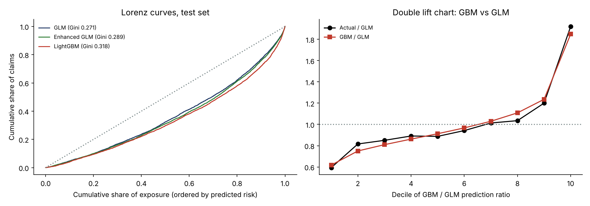
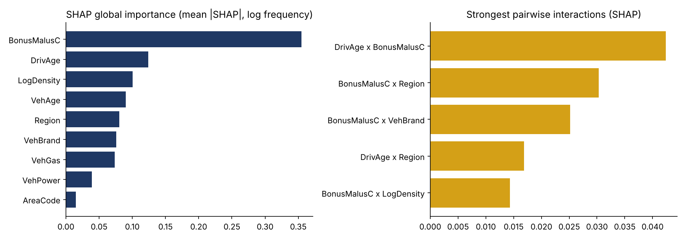
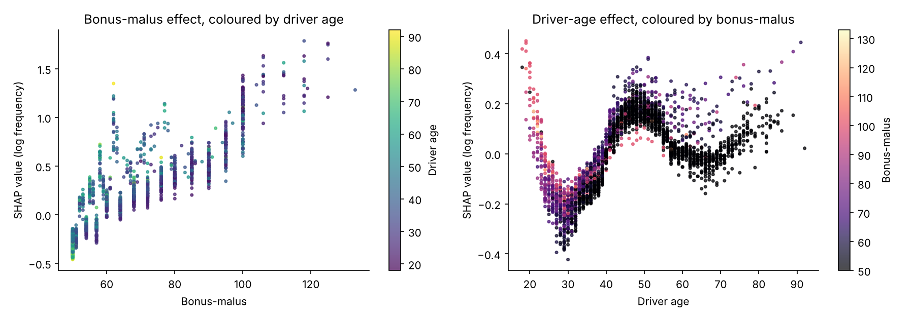
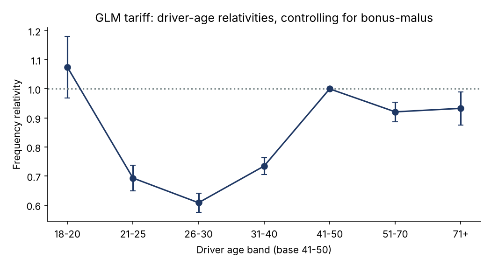

# Motor Insurance Pricing: Poisson GLM vs Gradient Boosting, SHAP and a GBM-Informed GLM

A complete motor third-party liability pricing study on **freMTPL2**, the reference public dataset for actuarial pricing (677,991 French policies, 26,405 claims, 358,000 years of exposure):

1. **Frequency GLM** (Poisson, log link, exposure offset), fitted by IRLS from scratch and validated against statsmodels.
2. **Gradient boosting** (LightGBM, Poisson objective, exposure offset), with early stopping.
3. **Explainability with SHAP**: global importance, dependence plots and pairwise interactions.
4. **A GBM-informed GLM**: the GLM is enhanced with the non-linearities and interactions revealed by SHAP, keeping a transparent multiplicative tariff.
5. **Severity GLM** (Gamma, log link) with a large-claim cap and loading, and the resulting **pure premium**.
6. **Model comparison** on a 20% hold-out set: Poisson deviance, Gini, calibration and a double lift chart.

## Key results (test set)

| Frequency model | Parameters | Poisson deviance (x100) | Deviance reduction | Gini |
|---|---|---|---|---|
| Homogeneous (no rating factors) | 1 | 25.39 | 0.0% | 0.01 (noise) |
| Poisson GLM | 51 | 24.37 | 4.0% | 0.271 |
| GLM enhanced with GBM insights | 82 | 24.22 | 4.6% | 0.289 |
| LightGBM | 736 trees | 23.85 | 6.1% | 0.318 |



**What the table says:**

- **Gradient boosting wins on predictive power.** It improves the GLM's ability to rank risks (Gini 0.318 vs 0.271). The double lift chart shows where: when the two models disagree, actual claims broadly follow the GBM, especially at the extremes.
- **The GLM keeps most of the value.** It captures two-thirds of the GBM's deviance reduction (4.0% of 6.1%) with a tariff of 51 transparent factors that an underwriter, a regulator or a customer can understand.
- **SHAP closes part of the gap.** The GBM shows where the GLM is too simple. Adding what it reveals (non-linear bonus-malus and density, interactions of bonus-malus with driver age and region) closes 30 to 40% of the gap while remaining a GLM. This is how modern pricing teams use machine learning: to improve the tariff, not to replace it blindly.

### How the enhanced GLM was chosen (without touching the test set)

Candidate enhancements were compared on a validation split carved out of the training data (the same split used for the GBM's early stopping). The test set was used only once, for the final comparison.

| Candidate | Parameters | Validation deviance (x100) |
|---|---|---|
| Base GLM | 51 | 23.926 |
| + driver age x bonus-malus | 57 | 23.927 |
| + non-linear shapes (bonus-malus, density) | 55 | 23.845 |
| + shapes + driver age x bonus-malus | 61 | 23.839 |
| **+ shapes + both interactions (selected)** | 82 | **23.798** |

The strongest SHAP interaction does not help **on its own**: most of the gain comes from the non-linear shapes, and the interactions only add value once those shapes are in the model. A SHAP interaction is a hint about where to look, not a ready-made GLM term.

## Validation

| Check | Result |
|---|---|
| Frequency GLM coefficients vs statsmodels | max difference 1.5e-13 |
| Frequency GLM standard errors vs statsmodels | max difference 1.5e-10 |
| Severity GLM (Gamma) coefficients vs statsmodels | max difference 9.1e-13 |
| Balance property, Poisson GLM on training data | 21,076 predicted = 21,076 observed |
| Calibration on the test set (predicted / actual claims) | 99.5% (GLM), 99.6% (GBM) |
| Model selection | Enhancements chosen on a validation split; the test set is used once, at the end |
| Pure premium on capped claim amounts (predicted / actual) | 103% |

**Three findings from the validation work:**

- **The large-claim loading is volatile.** Uncapped pure premiums over-predict test-set amounts by 29%. The cause: claims above EUR 50,000 (73 claims, one of EUR 4.1m) make up 25% of amounts in the training set but only 6% in the test set. On capped amounts, the model is calibrated (103%). In practice, the large-claim loading should be calibrated on several years and the whole portfolio, not on a random split.
- **The raw file is not randomly ordered.** The homogeneous model first showed a Gini of 0.042 instead of zero, because tied predictions kept the file's order, and policies with claims cluster at the start of the file. Ties are now broken at random, and floating-point noise in predicted rates is rounded away before ranking.
- **The noise level is measured.** Across 200 random orderings, a model with no information has a Gini of 0.00 with a standard deviation of 0.008, so the homogeneous model's 0.014 is noise.

## Explainability: what drives claim frequency





- **Bonus-malus dominates.** It is by far the strongest predictor. In the GLM each point adds 2.8% to frequency, so moving from 50 (maximum bonus) to 100 multiplies the frequency by about 4.
- **Driver age is not monotonic.** Frequency is high for the youngest drivers, falls to a minimum around 30, peaks again around 45-55 (a commonly cited explanation is young drivers using their parents' car) and rises again after 75.
- **Bonus-malus and driver age interact.** At the same bonus-malus level, older drivers are riskier, because a malus means more for a driver who has had decades to earn a bonus.



In the GLM, the youngest drivers show a relativity of only 1.07 against the 41-50 base. This is because bonus-malus already captures much of their risk: young drivers start with a high bonus-malus. **Correlated rating factors share the effect**, and reading GLM relativities one by one requires this context.

## Method notes

- **Data cleaning:** the standard literature treatment, with claim counts capped at 4 and exposures at 1 year. Claim amounts are joined by policy. The train/test split is random (80/20, fixed seed).
- **Frequency GLM:** categorical bands for driver age, vehicle age, vehicle power, brand, fuel and region, plus continuous bonus-malus (capped at 150), log density and area code. The IRLS uses a working weight of exposure x mu and an offset of log(exposure).
- **LightGBM:** Poisson objective with log(exposure) as the initial score, 31 leaves, a minimum of 1,000 policies per leaf, row and feature subsampling and L2 regularisation. Early stopping on a 10% validation split stopped at 736 rounds.
- **Severity:** average claim amount per policy capped at EUR 50,000, Gamma GLM weighted by number of claims, and a large-claim loading of 1.33 (uncapped / capped amounts).
- **Metrics:** mean Poisson deviance, and the Gini of the exposure-weighted Lorenz curve with policies ordered by predicted frequency.

## Repository structure

```
├── run_study.py     # full study: models, SHAP, metrics, tables and charts
├── data/            # downloaded automatically on first run (not stored in the repository)
├── src/
│   ├── data.py      # download from CASdatasets, cleaning, rating factors
│   └── glm.py       # IRLS GLM (Poisson, Gamma), design matrices, deviance, Gini
└── results/
    ├── figures/
    ├── tables/      # model comparison, tariff relativities, validation, double lift
    └── run_log.txt
```

## How to run

```bash
pip install -r requirements.txt
python run_study.py
```

The first run downloads the data (about 10 MB) from the CASdatasets repository and caches a prepared file in `data/`.

## Limitations and next steps

- **Severity** is modelled with a simple GLM; a GBM or a spliced distribution (body and tail) would capture large claims better.
- **Hyperparameters** are set by judgement with early stopping; a cross-validated search and monotonic constraints (for example on bonus-malus) would make the GBM more robust and more acceptable to a regulator.
- **Credibility** for small regions and brands (GLM with random effects).
- **Commercial pricing:** from technical premium to market price, with retention and price elasticity.

## References

- Noll, A., Salzmann, R. and Wüthrich, M. (2018). Case study: French motor third-party liability claims. SSRN.
- Dutang, C. and Charpentier, A. CASdatasets: insurance datasets (R package).
- Lundberg, S. and Lee, S.-I. (2017). A unified approach to interpreting model predictions (SHAP). *NeurIPS*.

---

**Author:** Yassine El Bakali, MSc in Actuarial Science (ULB) · yelbakali@yahoo.be
